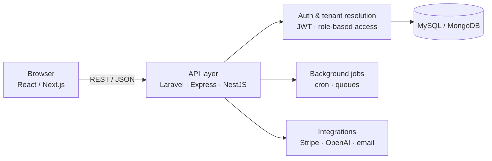

<div align="center">


<a href="https://git.io/typing-svg">
  
</a>

<br/>

<a href="https://www.eldiancore.com/"></a>
<a href="https://kashifdev.netlify.app/"></a>
<a href="https://www.linkedin.com/in/muhammad-kashif-rehman-16273a180/"></a>
<a href="https://wa.me/923429053896"></a>


</div>


## 01 / About

I'm a full stack developer from **Haripur, Khyber Pakhtunkhwa**. I build business software, CRM platforms and web applications, and I run **[Eldian Core](https://www.eldiancore.com/)**, a software and IT services company. I care about code that stays maintainable and software that fits how a business actually works.

```ts
const kashif = {
  role: "Full Stack Developer",
  based: "Haripur, KPK, Pakistan",
  company: "Eldian Core — software, web, SEO & cloud services",
  backend: ["PHP", "Laravel", "Node.js", "Express", "NestJS", "Python"],
  frontend: ["React", "Next.js", "Redux", "TypeScript", "Tailwind"],
  data: ["MySQL", "MongoDB"],
  focus: ["Multi-tenant CRM", "Workflow automation", "Business software"],
  mindset: "Build. Learn. Improve. Repeat."
};
```


## 02 / Eldian Core

[**Eldian Core**](https://www.eldiancore.com/) is a software team based in Haripur, serving Hazara, Islamabad and clients worldwide. The engineer who scopes your project is the one who builds it, and the source code is handed over at the end.

<table>
<tr>
<td width="33%" valign="top"><code>S/01</code><br/><b>Software Development</b><br/><sub>APIs, internal platforms, integrations</sub></td>
<td width="33%" valign="top"><code>S/02</code><br/><b>SEO & Search</b><br/><sub>Technical SEO, Core Web Vitals</sub></td>
<td width="33%" valign="top"><code>S/03</code><br/><b>UI/UX & Web Design</b><br/><sub>Design systems, fast marketing sites</sub></td>
</tr>
<tr>
<td valign="top"><code>S/04</code><br/><b>Digital Marketing</b><br/><sub>Paid search, automation, attribution</sub></td>
<td valign="top"><code>S/05</code><br/><b>Cloud & DevOps</b><br/><sub>Hosting, backups, monitoring</sub></td>
<td valign="top"><code>S/06</code><br/><b>IT Consulting</b><br/><sub>Reviews, roadmaps, support</sub></td>
</tr>
</table>

<div align="center">

[**Services →**](https://www.eldiancore.com/services) &nbsp;·&nbsp; [**Our work →**](https://www.eldiancore.com/projects) &nbsp;·&nbsp; [**Start a project →**](https://www.eldiancore.com/contact)

</div>


## 03 / Tech Stack

<table>
<tr>
<td width="22%"><code>BACKEND</code></td>
<td></td>
</tr>
<tr>
<td><code>FRONTEND</code></td>
<td></td>
</tr>
<tr>
<td><code>DATA</code></td>
<td></td>
</tr>
<tr>
<td><code>TOOLING</code></td>
<td></td>
</tr>
</table>


## 04 / Architecture

How most of my full-stack business apps are structured:



- **Multi-tenant by design:** one codebase serving many businesses, with data and permissions kept separate per tenant.
- **Role-based access:** admin, staff and customer views backed by token authentication.
- **Automation:** scheduled jobs and integrations that remove repetitive manual work.


## 05 / Selected Work

| Project | Stack | What it does | Link |
|---|---|---|---|
| **Multi-Tenant CRM** | Laravel · MySQL | Business management and CRM workflows across multiple tenants | Private (details on request) |
| **Call Dialer App** | TypeScript · MERN | Full-stack call dialer application | [Repository ↗](https://github.com/kashif-developer9053/call-dialer-app) |
| **Rapid Counsel** | React · Node · Express · MongoDB | Lawyer marketplace where lawyers find cases and users find legal support | [Portfolio ↗](https://kashifdev.netlify.app/#projects) |
| **AI-Powered Real Estate** | Next.js · Express · TypeScript · MongoDB | Real estate platform with OpenAI and Replicate, Stripe subscriptions, role-based auth and cron jobs | [Portfolio ↗](https://kashifdev.netlify.app/#projects) |
| **Eldian Core Website** | Next.js | Company website for services, products and case studies | [Live site ↗](https://www.eldiancore.com/) |

<sub>**More repositories:** [aa-perfume](https://github.com/kashif-developer9053/aa-perfume) · [Auto-Datesheet-Generator](https://github.com/kashif-developer9053/Auto-Datesheet-Generator) · [chocolate-factory](https://github.com/kashif-developer9053/chocolate-factory) · [redsolmarketingagency](https://github.com/kashif-developer9053/redsolmarketingagency)</sub>


## 06 / Experience

| Period | Role | Company |
|---|---|---|
| Jun 2023 – Present | Laravel Developer | J.Sons Communication |
| Sep 2023 – Apr 2024 | PHP Laravel Developer (Remote) | Wieser Agencies Panama |
| Jan 2018 – Present | Self-employed developer | Eldian Core and independent projects |


## 07 / GitHub Activity

<div align="center">


</div>


## 08 / Let's Work Together

Have a business problem that needs software? Tell me what is slowing you down. An engineer replies within one working day.

<div align="center">

<a href="https://www.eldiancore.com/contact"></a>
<a href="https://wa.me/923429053896"></a>
<a href="https://www.linkedin.com/in/muhammad-kashif-rehman-16273a180/"></a>

<br/><br/>


</div>
